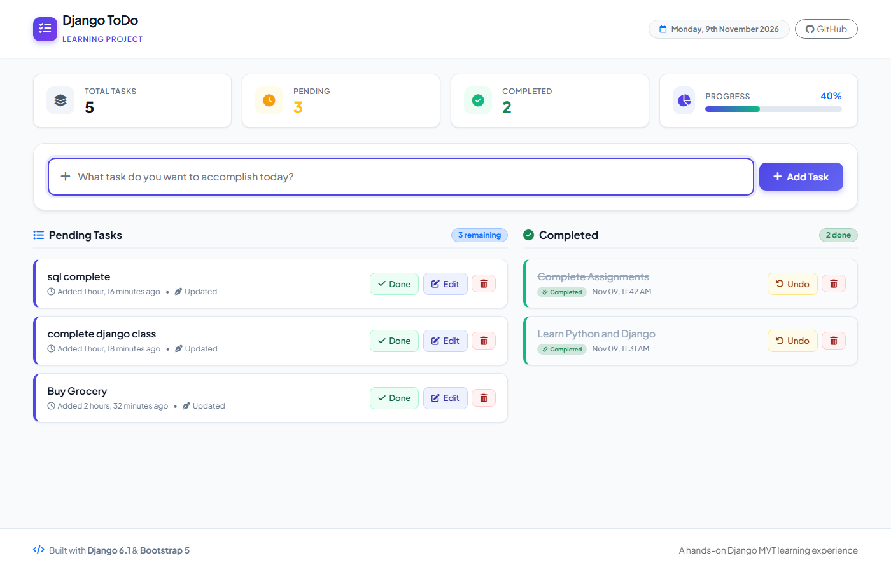
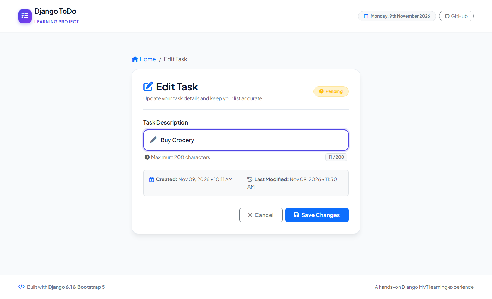
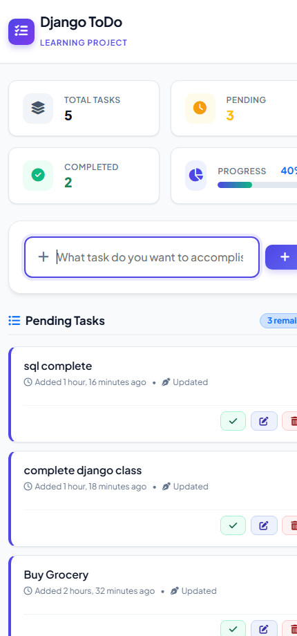

# 📋 Django ToDo Pro — Modern Task Management Web App

[](https://www.python.org/)
[](https://www.djangoproject.com/)
[](https://getbootstrap.com/)
[](https://www.sqlite.org/)
[](#license)

> A polished, feature-rich, and modern task management web application built with **Django 6.1** and **Bootstrap 5.3**. Created as a hands-on learning project to master the Django MVT architecture, ORM queries, database migrations, dynamic templating, and modern responsive frontend design.

---

## 📸 Screenshots & UI Showcase

### 🖥️ Desktop Dashboard
A clean productivity hub featuring live statistics, progress tracking, and side-by-side active and completed task columns:



---

### ✏️ Edit Task View
A dedicated editing screen with breadcrumb navigation, status badge, input length counter, and creation/modification timestamps:



---

### 📱 Responsive Mobile View
Seamless mobile layout with touch-friendly action buttons and adaptive navigation:

<p align="center">
  
</p>

---

## ✨ Features & UI Highlights

- **⚡ Full CRUD Operations**: Create, Read, Update, and Delete tasks effortlessly.
- **🔄 Two-Column Workflow**:
  - **Pending Tasks**: Active tasks with quick-action buttons to Mark Done, Edit, or Delete.
  - **Completed Tasks**: Archive of finished tasks with options to Undo (reopen) or permanently Delete.
- **📊 Real-time Productivity Analytics**:
  - Live metric cards showing **Total Tasks**, **Pending Tasks**, and **Completed Tasks**.
  - Dynamic **Progress Bar** calculating and visualizing the current completion percentage (`0% - 100%`).
- **🔔 Django Messages Notifications**:
  - Built-in flash messages for user actions (*Task created*, *Task updated*, *Task completed*, *Task deleted*).
  - Auto-dismissing alerts styled with custom Bootstrap color schemes and icons.
- **🛡️ Safe Deletions**:
  - Confirmation prompt before task deletion to avoid accidental data loss.
- **🎨 Modern Design System**:
  - Styled with the modern **Plus Jakarta Sans** typography from Google Fonts.
  - Vibrant indigo and emerald color accents, soft shadows, rounded corners, and smooth hover micro-animations.
  - Clean empty states with custom graphics and friendly messaging when task lists are clear.
- **📱 100% Mobile Responsive**:
  - Built mobile-first with Bootstrap 5.3 grid and custom CSS media queries for smartphones, tablets, and desktops.

---

## 🧠 What I Learned in This Project

This project was built from the ground up as a deep-dive learning journey into **Django** and full-stack web development. Here are the core concepts and skills mastered:

### 1. Django MVT (Model - View - Template) Architecture
- **Model (`todo_app/models.py`)**: Defined the data blueprint for `Task` using Django models. Understood field types like `CharField`, `BooleanField`, and automatic timestamping with `DateTimeField(auto_now_add=True)` and `DateTimeField(auto_now=True)`.
- **View (`todo_app/views.py`, `todo_main/views.py`)**: Mastered handling HTTP requests (`GET`, `POST`), querying the database via ORM, and returning rendered HTML responses or HTTP redirects.
- **Template (`todo_main/templates/`)**: Implemented dynamic rendering using the Django Template Engine (DTE), utilizing variables (`{{ task.task }}`), template filters (`timesince`, `date`), and template tags (``, ``, ``).

### 2. Django ORM (Object-Relational Mapping)
- Interacting with the SQLite database without writing raw SQL queries:
  - **Creating records**: `Task.objects.create(task=task_text)`
  - **Filtering & Splitting querysets**: `Task.objects.filter(is_completed=False)` and `Task.objects.filter(is_completed=True)`
  - **Sorting results**: `.order_by('-updated_at')` to display recently touched tasks first.
  - **Aggregating counts**: Using `.count()` to compute task statistics and calculate the completion percentage mathematically.
  - **Safe Lookups**: Using `get_object_or_404(Task, pk=pk)` to prevent 500 server errors when querying nonexistent tasks.
  - **Updating & Deleting**: Calling `task.save()` and `task.delete()` directly on model instances.
- Practiced Django migrations workflow: `python manage.py makemigrations` and `python manage.py migrate`.

### 3. URL Dispatching & Modular Routing
- Structured modular URLs by delegating app-specific routes to `todo_app/urls.py` via `include()` in `todo_main/urls.py`.
- Used path converters (`<int:pk>/`) to pass primary keys dynamically into view functions.
- Used named URL patterns (`name='home'`, `name='mark_as_done'`, `name='edit_task'`, etc.) and reverse URL lookups using `` in templates and `redirect('home')` in views.

### 4. Form Handling, CSRF Security & Data Validation
- Learned how HTML forms interact with Django views via HTTP POST.
- Understood and implemented CSRF (Cross-Site Request Forgery) token protection with `` to secure state-changing POST requests.
- Applied server-side input sanitization (`request.POST.get('task', '').strip()`) to guard against whitespace and empty submissions.

### 5. Template Inheritance & Component Reusability
- Refactored repetitive HTML structure into a clean `base.html` template.
- Utilized template inheritance blocks (``, ``, ``) to keep code DRY (Don't Repeat Yourself).
- Configured static files settings (`STATIC_URL`, `STATICFILES_DIRS`) and loaded them via ``.

### 6. User Experience (UX) & Flash Messaging
- Integrated Django's built-in `messages` framework (`django.contrib.messages`) to provide real-time feedback banners when tasks are added, completed, reopened, edited, or deleted.
- Added JavaScript auto-dismiss timers and confirmation dialogs for destructive actions.

### 7. Modern UI/UX Engineering
- Transformed a basic table/raw debug output into a modern SaaS-inspired dashboard.
- Replaced rigid inline styles and fixed absolute positioning with a responsive flexbox/grid layout.
- Designed custom stat cards, badge counters, status pills, and empty-state placeholders.

---

## 🛠️ Tech Stack & Libraries

| Category | Technology | Description |
|---|---|---|
| **Backend** | Python 3.13 | Core programming language |
| **Framework** | Django 6.1 | High-level Python web framework |
| **Database** | SQLite 3 | Relational database (Django default ORM backend) |
| **Frontend Styling** | Bootstrap 5.3.3 | Responsive CSS framework |
| **Custom Styling** | Vanilla CSS3 | Custom themes, gradients, and micro-animations (`static/css/style.css`) |
| **Typography** | Google Fonts | "Plus Jakarta Sans" for modern aesthetics |
| **Icons** | Font Awesome 6.5.1 | Comprehensive SVG vector icons |

---

## 📁 Project Structure

```text
TODO/
│
├── manage.py                     # Django CLI management script
├── db.sqlite3                    # SQLite database file
├── requirements.txt              # Project dependencies
├── README.md                     # Documentation with screenshots
│
├── screenshots/                  # Application UI screenshots
│   ├── dashboard-desktop.png
│   ├── dashboard-mobile.png
│   └── edit-task.png
│
├── static/
│   └── css/
│       └── style.css             # Custom CSS styling, variables & animations
│
├── todo_app/                     # Main To-Do application module
│   ├── migrations/               # Database migrations
│   │   └── 0001_initial.py
│   ├── admin.py                  # Django admin registration
│   ├── apps.py                   # App configuration
│   ├── models.py                 # Task model schema definition
│   ├── tests.py                  # Unit tests
│   ├── urls.py                   # App-specific URL routes
│   └── views.py                  # Task action views (add, toggle, edit, delete)
│
└── todo_main/                    # Project configuration directory
    ├── asgi.py                   # ASGI config
    ├── settings.py               # Global Django settings
    ├── urls.py                   # Root URL routing
    ├── views.py                  # Dashboard home view with stats
    ├── wsgi.py                   # WSGI config
    └── templates/                # HTML Templates
        ├── base.html             # Master layout with navbar & footer
        ├── home.html             # Main dashboard view
        ├── edit_task.html        # Task editing view
        └── addTask.html          # Fallback add task view
```

---

## 🚀 Getting Started

Follow these steps to run this project locally on your machine:

### 1. Clone the Repository
```bash
git clone https://github.com/MSIVAPAPARAO13/Todo.git
cd Todo
```

### 2. Create and Activate a Virtual Environment
- **Windows (Command Prompt / PowerShell)**:
  ```powershell
  python -m venv env
  .\env\Scripts\activate
  ```
- **macOS / Linux**:
  ```bash
  python3 -m venv env
  source env/bin/activate
  ```

### 3. Install Dependencies
```bash
pip install -r requirements.txt
```

### 4. Apply Database Migrations
```bash
python manage.py migrate
```

### 5. Create a Superuser (Optional, for Django Admin)
```bash
python manage.py createsuperuser
```

### 6. Run the Development Server
```bash
python manage.py runserver
```

Open your browser and navigate to:
```text
http://127.0.0.1:8000/
```

To access the Django Admin panel:
```text
http://127.0.0.1:8000/admin/
```

---

## 🔮 Future Enhancements & Roadmap

- [ ] **User Authentication**: Implement user registration, login, and multi-user task isolation using `django.contrib.auth`.
- [ ] **Task Categorization & Tags**: Add tags/categories (Work, Study, Personal) with colored labels.
- [ ] **Priority Levels & Due Dates**: Add Priority flags (High, Medium, Low) and calendar date pickers.
- [ ] **Search & Filter**: Client-side or server-side task search by keyword.
- [ ] **Dark Mode**: Toggleable dark theme for comfortable night-time productivity.
- [ ] **REST API**: Expose API endpoints using **Django REST Framework (DRF)**.

---

## 📄 License

This project is open-source and available under the [MIT License](LICENSE).

---

## 👨‍💻 Author

Developed with ❤️ as part of my **Python & Django Learning Journey**.  
Feel free to connect, star ⭐ the repository, or contribute!
